# AURZANE · revisión del rediseño

Capturas reales con el diseño nuevo aplicado (aún sin publicar). Se actualizan solas con cada cambio. Última: 24/11/2026, 19:59:52.

Cada página: ordenador (claro y oscuro) y móvil (claro y oscuro). Debajo, lo que la comprobación automática encontró.

1. [aurzane.com/](#p1)
2. [aurzane.com/research.html](#p2)
3. [aurzane.com/biblioteca/](#p3)
4. [aurzane.com/biblioteca/recientes/](#p4)
5. [aurzane.com/libros/](#p5)
6. [aurzane.com/biblioteca/libro/tormento.html](#p6)
7. [aurzane.com/articulos/](#p7)
8. [aurzane.com/articulos/minimalismo-huella-ecologica-bienestar/](#p8)
9. [aurzane.com/novedades/](#p9)
10. [aurzane.com/frases/](#p10)
11. [mind.aurzane.com/](#p11)
12. [aurzane.com/research.html?mundo=mind](#p12)
13. [mind.aurzane.com/test-de-ansiedad/](#p13)
14. [nexus.aurzane.com/](#p14)
15. [nexus.aurzane.com/universidades/](#p15)
16. [live.aurzane.com/](#p16)
17. [learn.aurzane.com/](#p17)
18. [learn.aurzane.com/cursos/](#p18)
19. [learn.aurzane.com/curso/autoestima-dia-a-dia/](#p19)
20. [build.aurzane.com/](#p20)
21. [build.aurzane.com/calculadora-hipoteca/](#p21)
22. [ovp.aurzane.com/](#p22)
23. [aurzane.com/contacto.html](#p23)
24. [aurzane.com/mapa/](#p24)
25. [aurzane.com/articulos/recientes/](#p25)
26. [mind.aurzane.com/en/anxiety-test-gad-7/](#p26)
27. [mind.aurzane.com/ejercicios/escaneo-corporal/](#p27)
28. [live.aurzane.com/calculadora-imc/](#p28)
29. [nexus.aurzane.com/universidades/espana/](#p29)
30. [nexus.aurzane.com/universidades/estados-unidos/harvard-university/](#p30)
31. [ovp.aurzane.com/informe-ejemplo.html](#p31)
32. [mind.aurzane.com/ejercicios/](#p32)
33. [aurzane.com/privacidad.html](#p33)
34. [aurzane.com/sobre-aurzane.html](#p34)
35. [mind.aurzane.com/test-de-personalidad/](#p35)
36. [mind.aurzane.com/en/](#p36)
37. [mind.aurzane.com/pt/](#p37)
38. [ovp.aurzane.com/portal.html](#p38)
39. [learn.aurzane.com/certificado/](#p39)
40. [nexus.aurzane.com/calculadora-nota-pau/](#p40)
41. [nexus.aurzane.com/universidades/espana/universidad-de-salamanca/](#p41)
42. [build.aurzane.com/alquiler-por-municipio/](#p42)
43. [aurzane.com/biblioteca/recientes/oa-W7134041508/](#p43)

## 1. aurzane.com/

[Abrir la página actual](https://aurzane.com/)

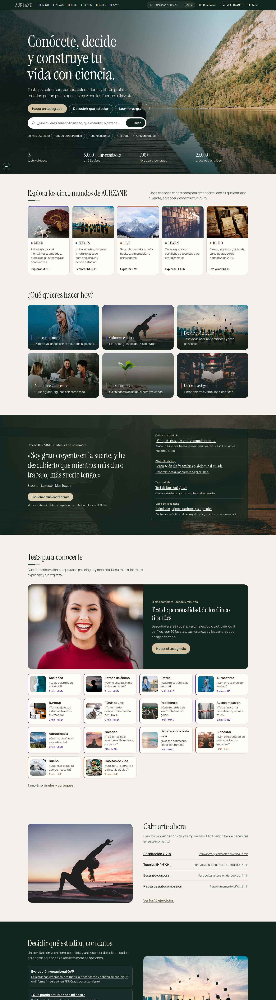 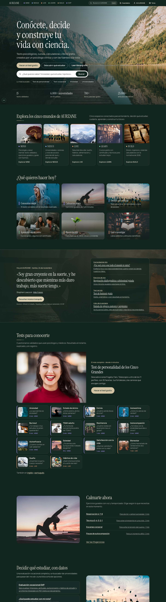

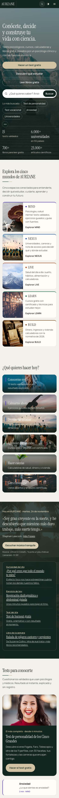 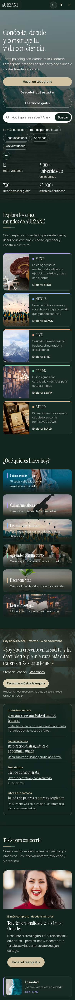

- Sin avisos automáticos

---

## 2. aurzane.com/research.html

[Abrir la página actual](https://aurzane.com/research.html)

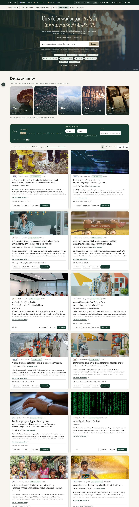 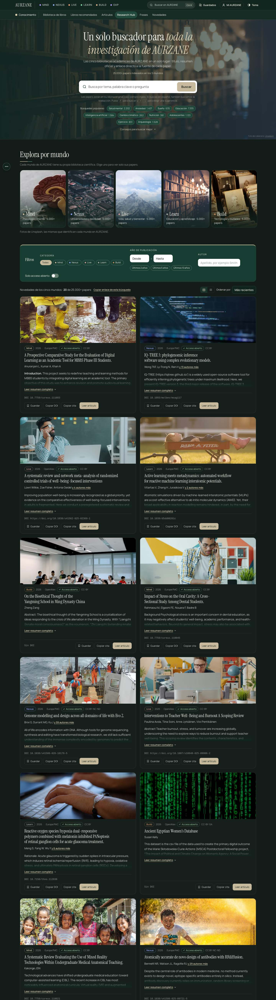

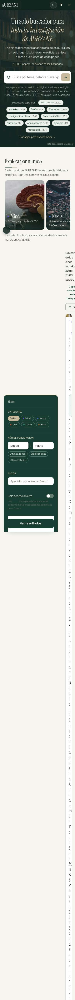 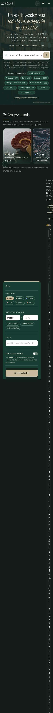

- escritorio claro: 30 textos con poco contraste (1.09 b: Mind; 1.31 small: Psicología y mente · 5.000+ papers; 1.09 b: Nexus)
- escritorio claro: se sale del ancho (div.lista-cab, h2, button.icon-btn)
- escritorio oscuro: 20 textos con poco contraste (1.36 a: A Prospective Comparative Study for the Evaluation; 1.36 a: IQ-TREE 3: phylogenomic inference software using c; 1.36 a: A systematic review and network meta-analysis of r)
- escritorio oscuro: se sale del ancho (div.lista-cab, h2, button.icon-btn)
- movil claro: 32 textos con poco contraste (1.09 b: Mind; 1.31 small: Psicología y mente · 5.000+ papers; 1.09 b: Nexus)
- movil claro: se sale del ancho (button.mundo-card, img, span)
- movil oscuro: 21 textos con poco contraste (3.83 p.nota: Hoy todos los papers del índice son de acceso abie; 1.36 a: A Prospective Comparative Study for the Evaluation; 1.36 a: IQ-TREE 3: phylogenomic inference software using c)
- movil oscuro: se sale del ancho (button.mundo-card, img, span)

---

## 3. aurzane.com/biblioteca/

[Abrir la página actual](https://aurzane.com/biblioteca/)

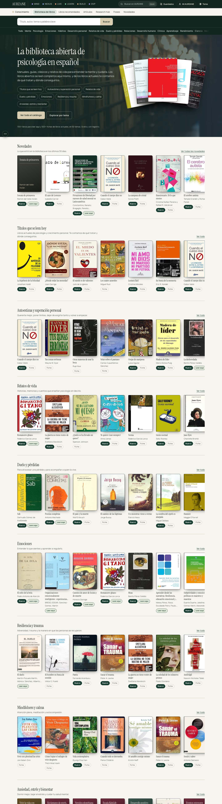 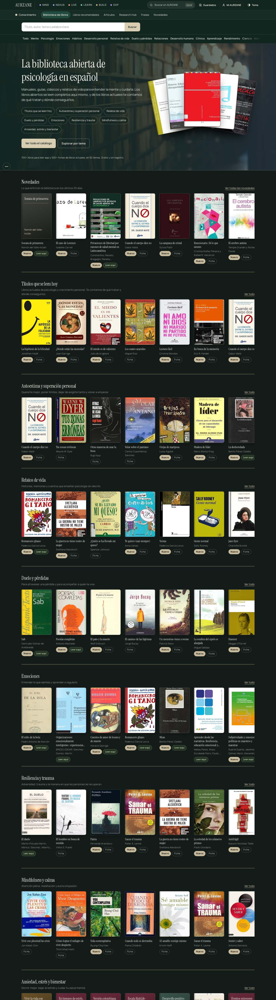

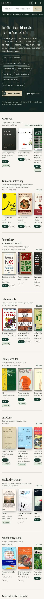 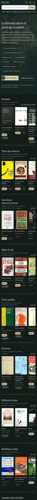

- escritorio claro: 12 textos con poco contraste (1.00 h1: La biblioteca abierta de psicología en español; 1.20 p.lead: Manuales, guías, clásicos y relatos de vida para e; 2.40 a.tipo-c: Títulos que se leen hoy)
- escritorio claro: se pisan TDAH: funciones ejecutivas y d ⟷ Educación y discapacidades. Ed; Educación y discapacidades. Ed ⟷ Aplicación del paradigma de ca
- escritorio claro: se sale del ancho (button.depto, a.libro, div.portada)
- escritorio oscuro: se pisan TDAH: funciones ejecutivas y d ⟷ Educación y discapacidades. Ed; Educación y discapacidades. Ed ⟷ Aplicación del paradigma de ca
- escritorio oscuro: se sale del ancho (button.depto, a.libro, div.portada)
- movil claro: 12 textos con poco contraste (1.00 h1: La biblioteca abierta de psicología en español; 1.20 p.lead: Manuales, guías, clásicos y relatos de vida para e; 2.40 a.tipo-c: Títulos que se leen hoy)
- movil claro: se sale del ancho (button.depto, button.depto, button.depto)
- movil oscuro: se sale del ancho (button.depto, button.depto, button.depto)

---

## 4. aurzane.com/biblioteca/recientes/

[Abrir la página actual](https://aurzane.com/biblioteca/recientes/)

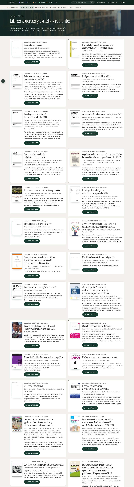 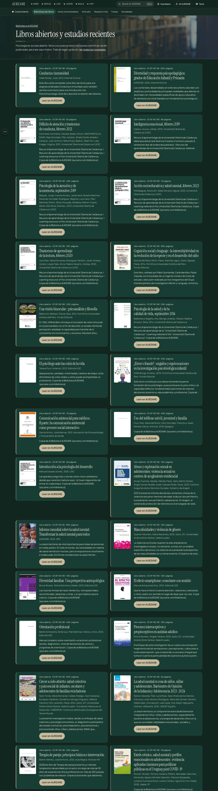

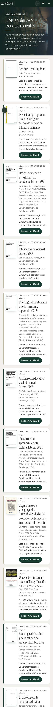 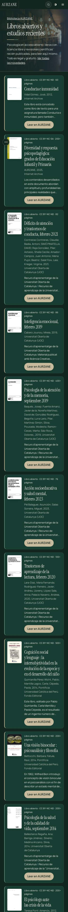

- Sin avisos automáticos

---

## 5. aurzane.com/libros/

[Abrir la página actual](https://aurzane.com/libros/)

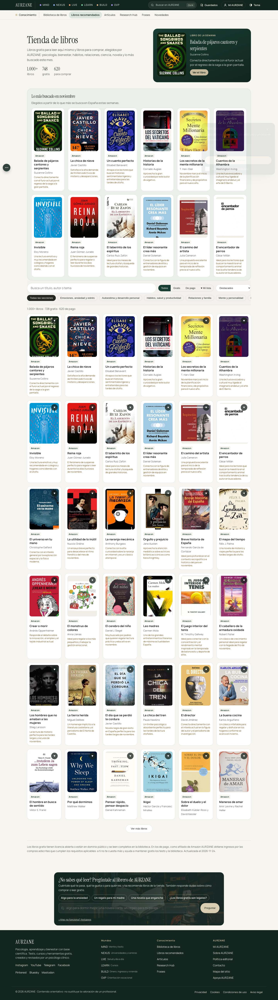 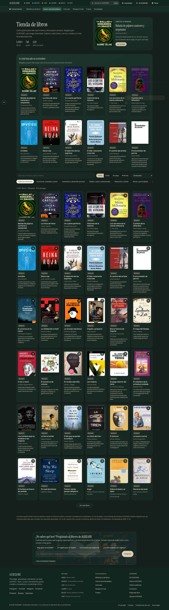

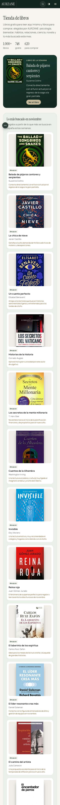 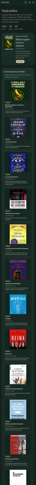

- escritorio claro: se sale del ancho (button, button, button)
- escritorio oscuro: se sale del ancho (button, button, button)
- movil claro: se sale del ancho (button, button, button)
- movil oscuro: se sale del ancho (button, button, button)

---

## 6. aurzane.com/biblioteca/libro/tormento.html

[Abrir la página actual](https://aurzane.com/biblioteca/libro/tormento.html)

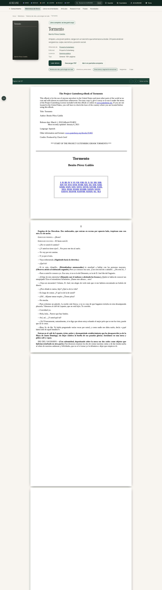 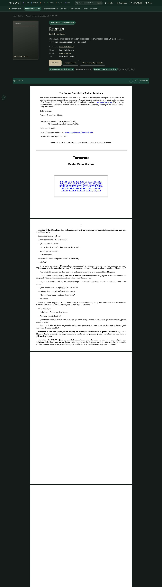

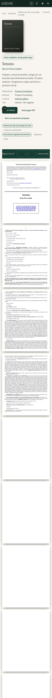 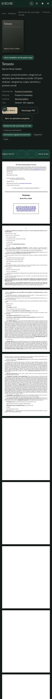

- Sin avisos automáticos

---

## 7. aurzane.com/articulos/

[Abrir la página actual](https://aurzane.com/articulos/)

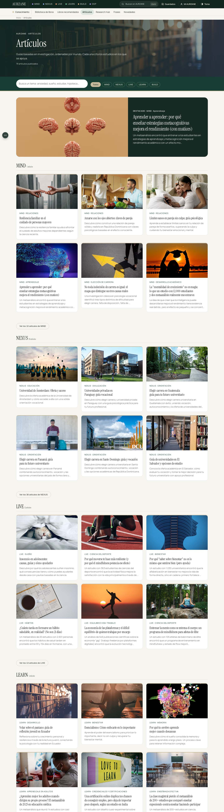 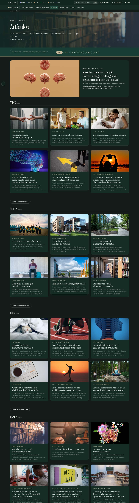

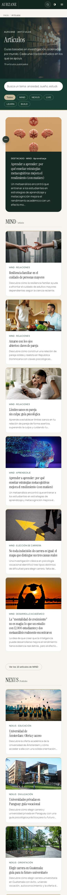 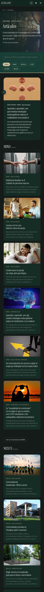

- Sin avisos automáticos

---

## 8. aurzane.com/articulos/minimalismo-huella-ecologica-bienestar/

[Abrir la página actual](https://aurzane.com/articulos/minimalismo-huella-ecologica-bienestar/)

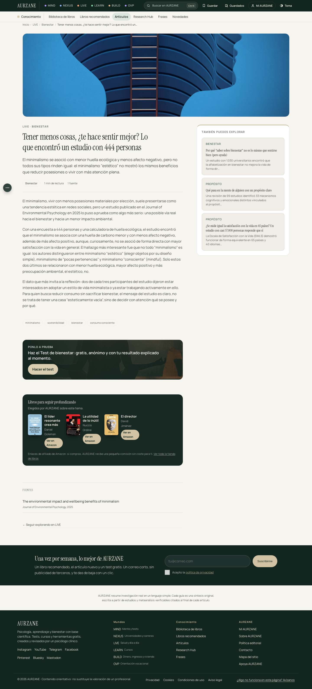 

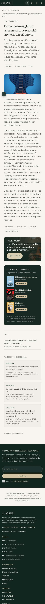 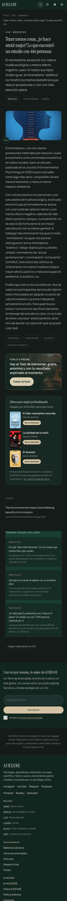

- Sin avisos automáticos

---

## 9. aurzane.com/novedades/

[Abrir la página actual](https://aurzane.com/novedades/)

 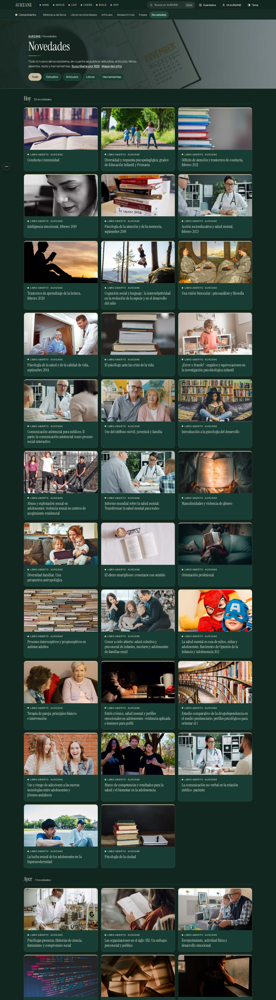

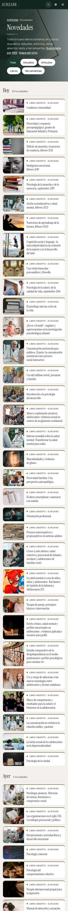 

- movil claro: se pisan Suscríbete por RSS ⟷ Mapa del sitio
- movil oscuro: se pisan Suscríbete por RSS ⟷ Mapa del sitio

---

## 10. aurzane.com/frases/

[Abrir la página actual](https://aurzane.com/frases/)

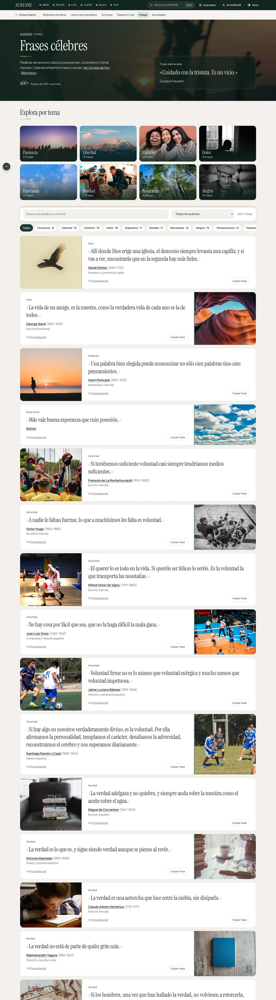 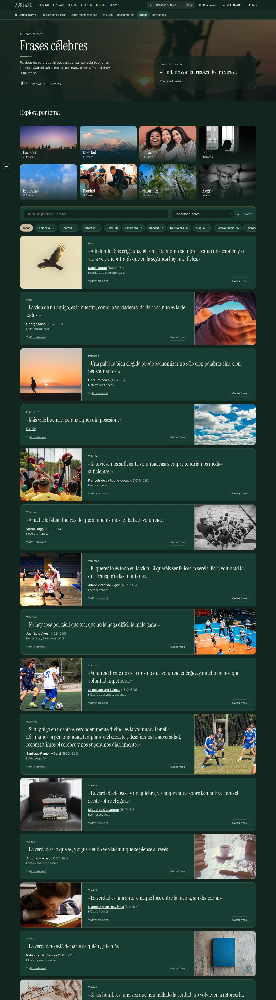

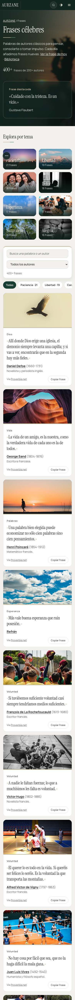 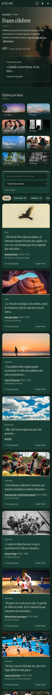

- escritorio claro: se sale del ancho (button, button, button)
- escritorio oscuro: se sale del ancho (button, button, button)
- movil claro: se sale del ancho (button, button, button)
- movil oscuro: se sale del ancho (button, button, button)

---

## 11. mind.aurzane.com/

[Abrir la página actual](https://mind.aurzane.com/)

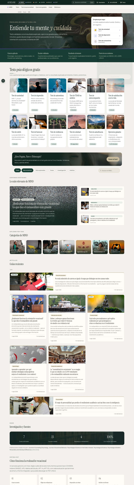 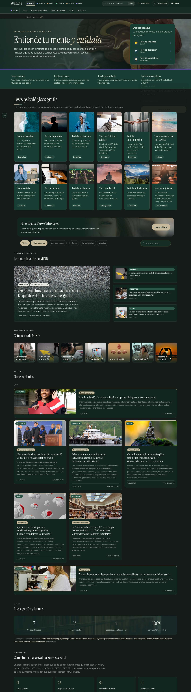

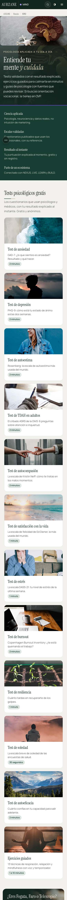 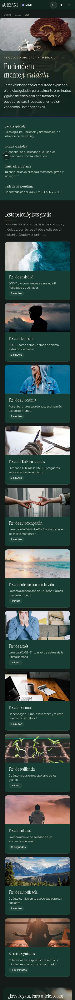

- escritorio claro: 7 textos con poco contraste (1.08 span.tipo-tag: Research; 1.08 span.cat-badge: Orientación vocacional; 2.10 h3: ¿Realmente funciona la orientación vocacional? Lo )
- escritorio oscuro: 2 textos con poco contraste (1.08 span.tipo-tag: Research; 1.08 span.cat-badge: Orientación vocacional)
- movil claro: 7 textos con poco contraste (1.08 span.tipo-tag: Research; 1.08 span.cat-badge: Orientación vocacional; 2.10 h3: ¿Realmente funciona la orientación vocacional? Lo )
- movil oscuro: 2 textos con poco contraste (1.08 span.tipo-tag: Research; 1.08 span.cat-badge: Orientación vocacional)

---

## 12. aurzane.com/research.html?mundo=mind

[Abrir la página actual](https://aurzane.com/research.html?mundo=mind)

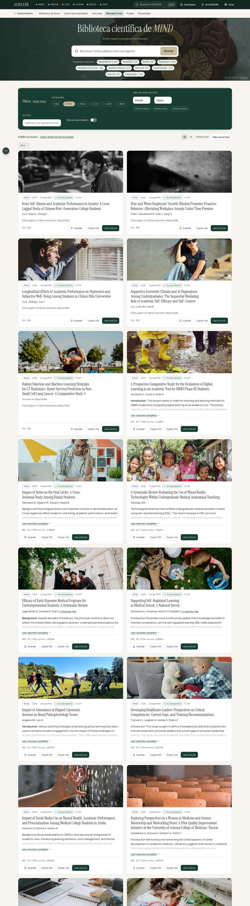 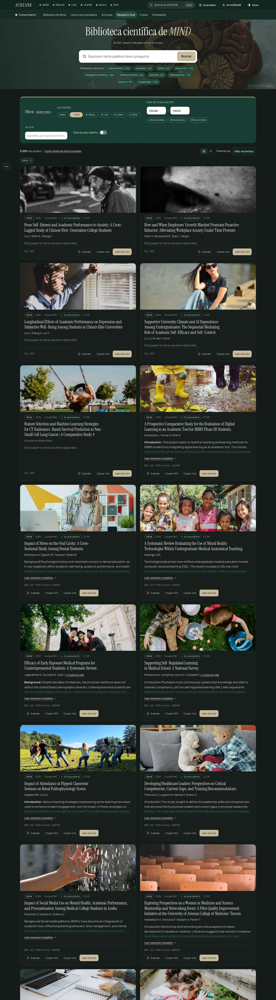

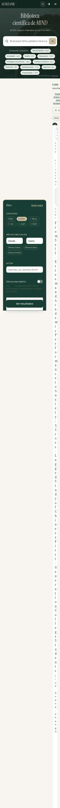 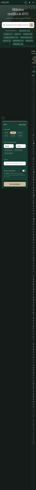

- escritorio claro: 20 textos con poco contraste (1.26 a: From Self-Esteem and Academic Performance to Anxie; 1.26 a: How and When Employees’ Growth Mindset Promotes Pr; 1.26 a: Longitudinal Effects of Academic Performance on De)
- escritorio claro: se sale del ancho (div.lista-cab, h2, button.icon-btn)
- escritorio oscuro: 20 textos con poco contraste (1.36 a: From Self-Esteem and Academic Performance to Anxie; 1.36 a: How and When Employees’ Growth Mindset Promotes Pr; 1.36 a: Longitudinal Effects of Academic Performance on De)
- escritorio oscuro: se sale del ancho (div.lista-cab, h2, button.icon-btn)
- movil claro: 22 textos con poco contraste (1.88 p.nota: Hoy todos los papers del índice son de acceso abie; 1.00 b: todos; 1.26 a: From Self-Esteem and Academic Performance to Anxie)
- movil claro: se sale del ancho (div.barra-izq, div.result-count, button.link-btn)
- movil oscuro: 21 textos con poco contraste (3.83 p.nota: Hoy todos los papers del índice son de acceso abie; 1.36 a: From Self-Esteem and Academic Performance to Anxie; 1.36 a: How and When Employees’ Growth Mindset Promotes Pr)
- movil oscuro: se sale del ancho (div.barra-izq, div.result-count, button.link-btn)

---

## 13. mind.aurzane.com/test-de-ansiedad/

[Abrir la página actual](https://mind.aurzane.com/test-de-ansiedad/)

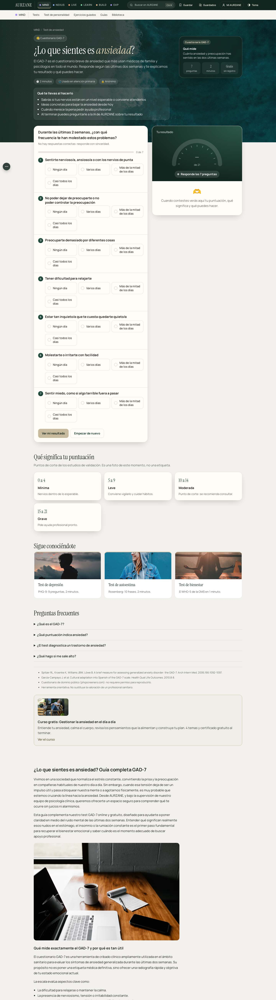 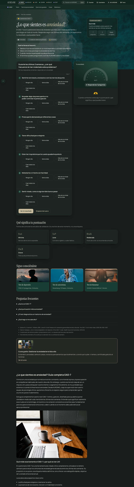

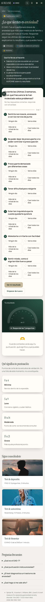 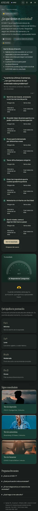

- Sin avisos automáticos

---

## 14. nexus.aurzane.com/

[Abrir la página actual](https://nexus.aurzane.com/)

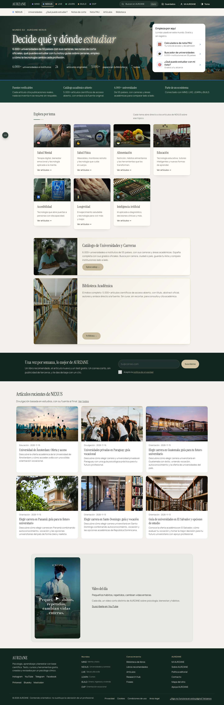 

 

- Sin avisos automáticos

---

## 15. nexus.aurzane.com/universidades/

[Abrir la página actual](https://nexus.aurzane.com/universidades/)

 

 

- Sin avisos automáticos

---

## 16. live.aurzane.com/

[Abrir la página actual](https://live.aurzane.com/)

 

 

- escritorio claro: 7 textos con poco contraste (1.08 span.tipo-tag: Guide; 1.08 span.cat-badge: Bienestar; 2.38 h3: Por qué "saber sobre bienestar" no es lo mismo que)
- escritorio oscuro: 2 textos con poco contraste (1.08 span.tipo-tag: Guide; 1.08 span.cat-badge: Bienestar)
- movil claro: 7 textos con poco contraste (1.08 span.tipo-tag: Guide; 1.08 span.cat-badge: Bienestar; 2.38 h3: Por qué "saber sobre bienestar" no es lo mismo que)
- movil oscuro: 2 textos con poco contraste (1.08 span.tipo-tag: Guide; 1.08 span.cat-badge: Bienestar)

---

## 17. learn.aurzane.com/

[Abrir la página actual](https://learn.aurzane.com/)

 

 

- escritorio claro: 7 textos con poco contraste (1.08 span.tipo-tag: Research; 1.08 span.cat-badge: Dominio y experticia; 2.38 h3: Práctica deliberada: cuánto explica realmente el d)
- escritorio oscuro: 2 textos con poco contraste (1.08 span.tipo-tag: Research; 1.08 span.cat-badge: Dominio y experticia)
- movil claro: 7 textos con poco contraste (1.08 span.tipo-tag: Research; 1.08 span.cat-badge: Dominio y experticia; 2.38 h3: Práctica deliberada: cuánto explica realmente el d)
- movil oscuro: 2 textos con poco contraste (1.08 span.tipo-tag: Research; 1.08 span.cat-badge: Dominio y experticia)

---

## 18. learn.aurzane.com/cursos/

[Abrir la página actual](https://learn.aurzane.com/cursos/)

 

 

- escritorio claro: 2 textos con poco contraste (1.01 h1: Cursos gratis, a tu ritmo; 1.19 p.lead: Cursos completos en español con lecciones, mapas, )
- movil claro: 2 textos con poco contraste (1.01 h1: Cursos gratis, a tu ritmo; 1.19 p.lead: Cursos completos en español con lecciones, mapas, )

---

## 19. learn.aurzane.com/curso/autoestima-dia-a-dia/

[Abrir la página actual](https://learn.aurzane.com/curso/autoestima-dia-a-dia/)

 

 

- movil claro: se pisan Imagen de portada: ⟷ Wikimedia Commons
- movil oscuro: se pisan Imagen de portada: ⟷ Wikimedia Commons

---

## 20. build.aurzane.com/

[Abrir la página actual](https://build.aurzane.com/)

 

 

- escritorio claro: 7 textos con poco contraste (1.08 span.tipo-tag: Research; 1.08 span.cat-badge: Construcción sostenible; 2.38 h3: La certificación LEED no ahorra energía en promedi)
- escritorio claro: se pisan American Economic Review (NBER ⟷ National Bureau of Economic Re; CEOs for Cities ⟷ National Bureau of Economic Re
- escritorio oscuro: 2 textos con poco contraste (1.08 span.tipo-tag: Research; 1.08 span.cat-badge: Construcción sostenible)
- escritorio oscuro: se pisan American Economic Review (NBER ⟷ National Bureau of Economic Re; CEOs for Cities ⟷ National Bureau of Economic Re
- movil claro: 7 textos con poco contraste (1.08 span.tipo-tag: Research; 1.08 span.cat-badge: Construcción sostenible; 2.38 h3: La certificación LEED no ahorra energía en promedi)
- movil oscuro: 2 textos con poco contraste (1.08 span.tipo-tag: Research; 1.08 span.cat-badge: Construcción sostenible)

---

## 21. build.aurzane.com/calculadora-hipoteca/

[Abrir la página actual](https://build.aurzane.com/calculadora-hipoteca/)

 

 

- Sin avisos automáticos

---

## 22. ovp.aurzane.com/

[Abrir la página actual](https://ovp.aurzane.com/)

 

 

- Sin avisos automáticos

---

## 23. aurzane.com/contacto.html

[Abrir la página actual](https://aurzane.com/contacto.html)

 

 

- movil claro: se pisan Privacidad ⟷ Condiciones de uso; Cookies ⟷ Condiciones de uso
- movil oscuro: se pisan Privacidad ⟷ Condiciones de uso; Cookies ⟷ Condiciones de uso

---

## 24. aurzane.com/mapa/

[Abrir la página actual](https://aurzane.com/mapa/)

 

 

- Sin avisos automáticos

---

## 25. aurzane.com/articulos/recientes/

[Abrir la página actual](https://aurzane.com/articulos/recientes/)

 

 

- escritorio claro: se pisan Todos los artículos ⟷ Novedades
- escritorio oscuro: se pisan Todos los artículos ⟷ Novedades

---

## 26. mind.aurzane.com/en/anxiety-test-gad-7/

[Abrir la página actual](https://mind.aurzane.com/en/anxiety-test-gad-7/)

 

 

- Sin avisos automáticos

---

## 27. mind.aurzane.com/ejercicios/escaneo-corporal/

[Abrir la página actual](https://mind.aurzane.com/ejercicios/escaneo-corporal/)

 

 

- Sin avisos automáticos

---

## 28. live.aurzane.com/calculadora-imc/

[Abrir la página actual](https://live.aurzane.com/calculadora-imc/)

 

 

- Sin avisos automáticos

---

## 29. nexus.aurzane.com/universidades/espana/

[Abrir la página actual](https://nexus.aurzane.com/universidades/espana/)

 

 

- escritorio claro: 6 textos con poco contraste (1.09 span.mono: UC; 1.35 span: UL; 1.35 span: UC)
- escritorio oscuro: 14 textos con poco contraste (1.66 span: UP; 1.66 span: UA; 1.66 span: US)
- movil claro: 13 textos con poco contraste (1.09 span.mono: UE; 1.09 span.mono: UM; 1.09 span.mono: UV)
- movil oscuro: 13 textos con poco contraste (1.09 span.mono: UC; 1.09 span.mono: UE; 1.09 span.mono: UM)

---

## 30. nexus.aurzane.com/universidades/estados-unidos/harvard-university/

[Abrir la página actual](https://nexus.aurzane.com/universidades/estados-unidos/harvard-university/)

 

 

- Sin avisos automáticos

---

## 31. ovp.aurzane.com/informe-ejemplo.html

[Abrir la página actual](https://ovp.aurzane.com/informe-ejemplo.html)

 

 

- movil claro: se sale del ancho (thead, tr, th)
- movil oscuro: se sale del ancho (thead, tr, th)

---

## 32. mind.aurzane.com/ejercicios/

[Abrir la página actual](https://mind.aurzane.com/ejercicios/)

 

 

- Sin avisos automáticos

---

## 33. aurzane.com/privacidad.html

[Abrir la página actual](https://aurzane.com/privacidad.html)

 

 

- escritorio claro: se pisan Contacto para privacidad ⟷ formulario de contacto; hola@aurzane.com ⟷ formulario de contacto
- escritorio oscuro: se pisan Contacto para privacidad ⟷ formulario de contacto; hola@aurzane.com ⟷ formulario de contacto

---

## 34. aurzane.com/sobre-aurzane.html

[Abrir la página actual](https://aurzane.com/sobre-aurzane.html)

 

 

- movil claro: se pisan Privacidad ⟷ Condiciones de uso; Cookies ⟷ Condiciones de uso
- movil oscuro: se pisan Privacidad ⟷ Condiciones de uso; Cookies ⟷ Condiciones de uso

---

## 35. mind.aurzane.com/test-de-personalidad/

[Abrir la página actual](https://mind.aurzane.com/test-de-personalidad/)

 

 

- escritorio claro: 18 textos con poco contraste (3.30 b: Fogata; 3.30 span: Reúnes a la gente y la haces sentir en casa.; 4.35 b: Timón)
- escritorio claro: se sale del ancho (span.blob)
- escritorio oscuro: 18 textos con poco contraste (3.30 b: Fogata; 3.30 span: Reúnes a la gente y la haces sentir en casa.; 4.35 b: Timón)
- escritorio oscuro: se sale del ancho (span.blob)
- movil claro: 18 textos con poco contraste (3.30 b: Fogata; 3.30 span: Reúnes a la gente y la haces sentir en casa.; 4.35 b: Timón)
- movil claro: se sale del ancho (span.blob)
- movil oscuro: 18 textos con poco contraste (3.30 b: Fogata; 3.30 span: Reúnes a la gente y la haces sentir en casa.; 4.35 b: Timón)
- movil oscuro: se sale del ancho (span.blob)

---

## 36. mind.aurzane.com/en/

[Abrir la página actual](https://mind.aurzane.com/en/)

 

 

- Sin avisos automáticos

---

## 37. mind.aurzane.com/pt/

[Abrir la página actual](https://mind.aurzane.com/pt/)

 

 

- Sin avisos automáticos

---

## 38. ovp.aurzane.com/portal.html

[Abrir la página actual](https://ovp.aurzane.com/portal.html)

 

 

- Sin avisos automáticos

---

## 39. learn.aurzane.com/certificado/

[Abrir la página actual](https://learn.aurzane.com/certificado/)

 

 

- Sin avisos automáticos

---

## 40. nexus.aurzane.com/calculadora-nota-pau/

[Abrir la página actual](https://nexus.aurzane.com/calculadora-nota-pau/)

 

 

- escritorio claro: 1 textos con poco contraste (1.04 span: Rellena tu media y las notas de la fase de acceso)
- movil claro: 1 textos con poco contraste (1.04 span: Rellena tu media y las notas de la fase de acceso)

---

## 41. nexus.aurzane.com/universidades/espana/universidad-de-salamanca/

[Abrir la página actual](https://nexus.aurzane.com/universidades/espana/universidad-de-salamanca/)

 

 

- Sin avisos automáticos

---

## 42. build.aurzane.com/alquiler-por-municipio/

[Abrir la página actual](https://build.aurzane.com/alquiler-por-municipio/)

 

 

- Sin avisos automáticos

---

## 43. aurzane.com/biblioteca/recientes/oa-W7134041508/

[Abrir la página actual](https://aurzane.com/biblioteca/recientes/oa-W7134041508/)

 

 

- Sin avisos automáticos

---

